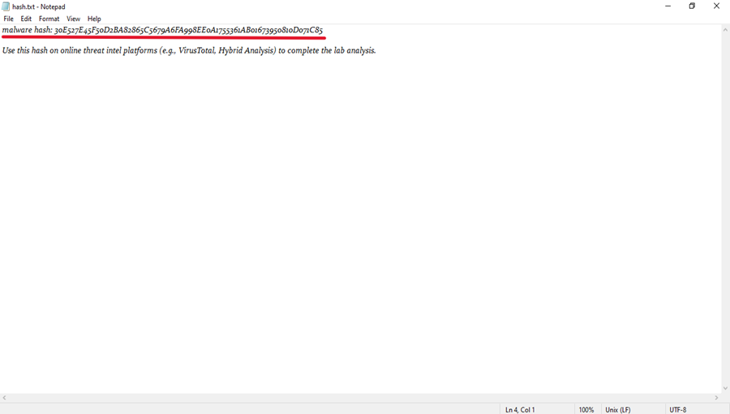
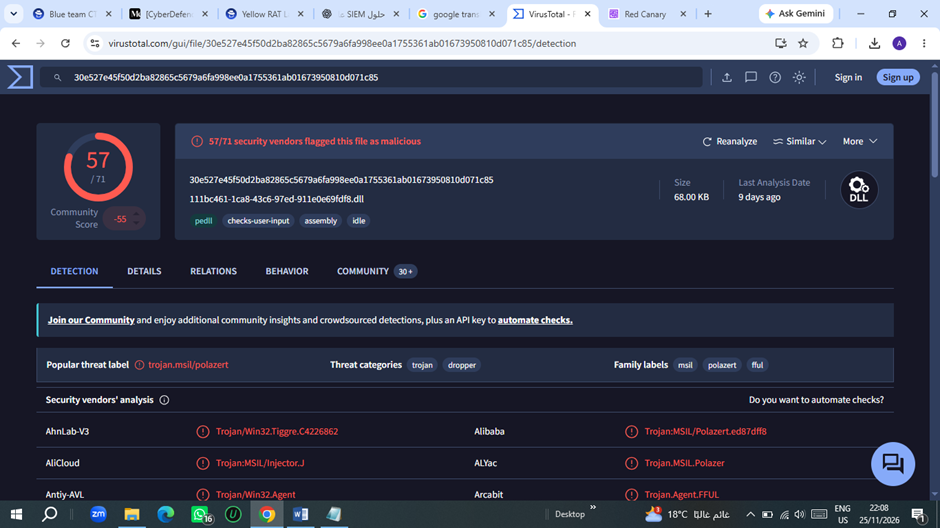
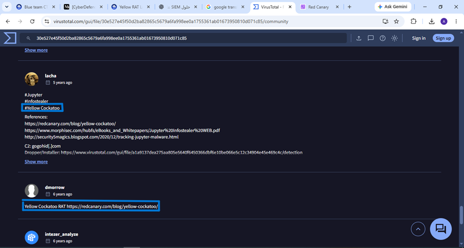
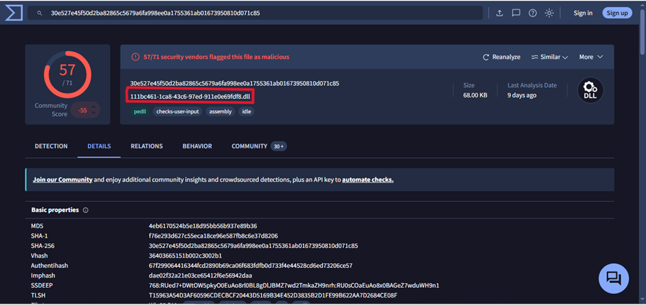
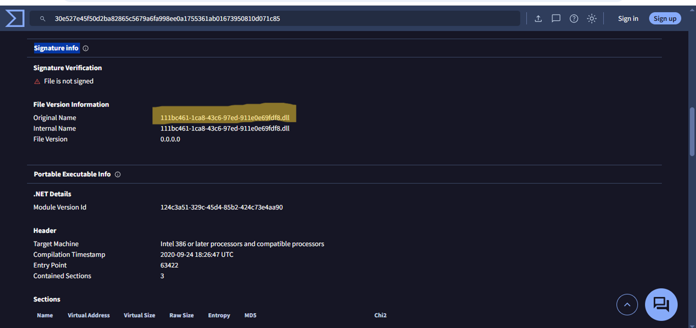
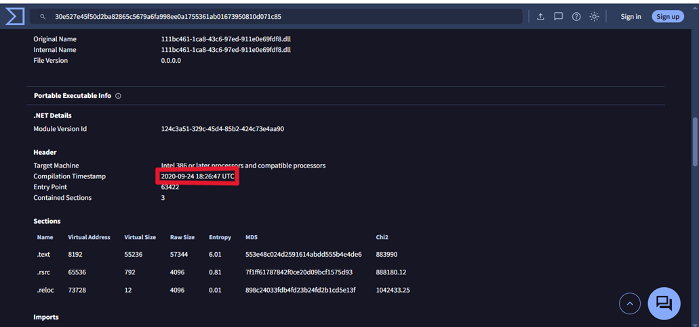
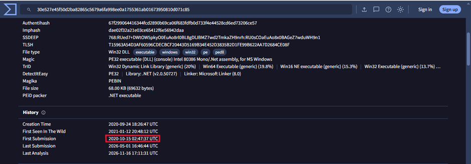
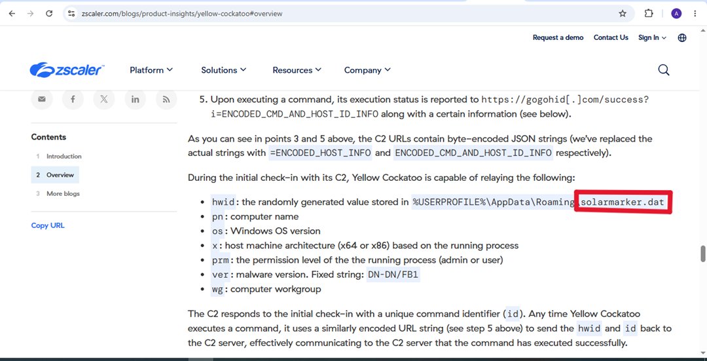

# Yellow RAT Lab Write-Up: Tracking Yellow Cockatoo (SolarMarker) with VirusTotal and Red Canary

*A blue-team walkthrough using only open-source threat intelligence.*

## Introduction

In this lab we investigate an incident at **GlobalTech Industries**. During a routine IT security check, abnormal network traffic was detected from multiple workstations, and some employees' search queries were being redirected to unfamiliar websites.

The goal is to find the root cause, analyze the malicious artifact, and extract indicators of compromise (IOCs) that let us hunt for the infection on other machines and block its communication. The only starting point is a single file hash.

**Tools used:** VirusTotal, Red Canary blog, Zscaler ThreatLabz blog

## Scenario

Abnormal network traffic from several workstations, plus search redirections to unknown websites. Our task is to identify the malware, understand how it behaves, and gather everything we need for containment and eradication. The lab hands us a single file, `hash.txt`, containing the malware's SHA256:

`30e527e45f50d2ba82865c5679a6fa998ee0a1755361ab01673950810d071c85`

## tools
VirusTotal 
Red Canary
## Analysis

### Q1: What name does Red Canary use for the threat cluster associated with the SHA256?

We start by searching the hash on VirusTotal. The popular threat label (`trojan.msil/polazert`) does not match the format the question asks for, but it tells us the sample is a **Jupyter Infostealer**.

Vendor labels are inconsistent across the industry, so the **Community** tab is worth checking. Plenty of analysts comment there, and the comments point us to Red Canary's technical analysis, where this activity cluster is tracked under its own name.

> **Answer: Yellow Cockatoo**

*Takeaway: the same malware family can have many names (Jupyter, SolarMarker, Yellow Cockatoo). Pivoting between vendor naming schemes is a core part of threat intel work.*

### Q2: What is the common filename associated with this malware?

Knowing the filenames a sample is seen under helps us sweep other workstations. In VirusTotal, go to **Details → Names**, and look at the signature info section (Original Name / Internal Name).

> **Answer: `111bc461-1ca8-43c6-97ed-911e0e69fdf8.dll`**

A GUID-style DLL name is easy to miss by eye, but trivial to search for with EDR or file-system queries.

### Q3: What compilation timestamp does VirusTotal show?

PE files carry a compilation timestamp in their header. Scroll down the Details tab to **Portable Executable Info** and read the *Compilation Timestamp* field: `2020-09-24 18:26:47 UTC`.

> **Answer: 2020-09-24 18:26**

Keep in mind this value is set by the attacker's toolchain and can be forged, so treat it as a hint rather than proof.

### Q4: When was the malware first submitted to VirusTotal?

The first-submission date helps estimate how long a sample may have been circulating before detection, and whether it belongs to a recent campaign or an older, evolving threat. The History section shows the sample was first submitted on 2020-10-15 at 02:47:37 UTC.

> **Answer: 2020-10-15 02:47**

The gap between compilation (Sept 24) and first submission (Oct 15) is about three weeks, which gives a rough picture of the sample's early life.

### Q5: What .dat file does the malware drop in the AppData folder?

Red Canary's post names the threat, but the finer behavioral detail is in **Zscaler ThreatLabz's analysis of Yellow Cockatoo**. In its overview, the malware loads a randomly generated string from `%USERPROFILE%\AppData\Roaming\solarmarker.dat`, which serves as a unique identifier (`hwid`) for the host.

> **Answer: `solarmarker.dat`**

This is a high-value artifact for eradication: its presence on a host is a strong sign of infection, and the name also ties this cluster to the **SolarMarker** family.

### Q6: What C2 server does the malware communicate with?

Blocking the command-and-control (C2) server cuts off further data exfiltration and tasking. The same Zscaler analysis lists the C2 actions step by step: the malware collects host information, then connects to `https://gogohid[.]com/gate?q=ENCODED_HOST_INFO` to share it and retrieve its first command. It then parses commands in an infinite loop and reports execution status to `https://gogohid[.]com/success?i=ENCODED_CMD_AND_HOST_ID_INFO`. The host info it relays includes computer name, Windows version, architecture, privilege level, and workgroup.

![Zscaler analysis: C2 address gogohid[.]com](images/09-zscaler-c2.png)

> **Answer: `https://gogohid.com`**

## Indicators of Compromise

| Type | Value |
|---|---|
| SHA256 | `30e527e45f50d2ba82865c5679a6fa998ee0a1755361ab01673950810d071c85` |
| Threat cluster | Yellow Cockatoo (Red Canary) |
| Malware family | Jupyter Infostealer / SolarMarker |
| Filename | `111bc461-1ca8-43c6-97ed-911e0e69fdf8.dll` |
| Dropped file | `%USERPROFILE%\AppData\Roaming\solarmarker.dat` |
| C2 | `gogohid[.]com` |
| Compile time | 2020-09-24 18:26:47 UTC |
| First seen (VT) | 2020-10-15 02:47:37 UTC |

## Recommendations

- Block `gogohid.com` at the proxy, DNS, and firewall, and search historical logs for connections to it.
- Hunt for the DLL filename and `solarmarker.dat` across all endpoints.
- Reimage or clean affected hosts, and reset credentials used on them, since this is an infostealer.
- Investigate how the initial infection happened. Search redirection often points to a poisoned search or a malicious download.

## Conclusion

Starting from one hash, VirusTotal plus the Red Canary and Zscaler write-ups were enough to name the threat, collect filenames, dating clues, a dropped artifact, and the C2 server. That is everything needed to scope, contain, and clean the incident. The lesson: good threat intel pivoting turns a single hash into a full response plan.

*Thanks for reading. Follow for more blue-team lab write-ups.*
